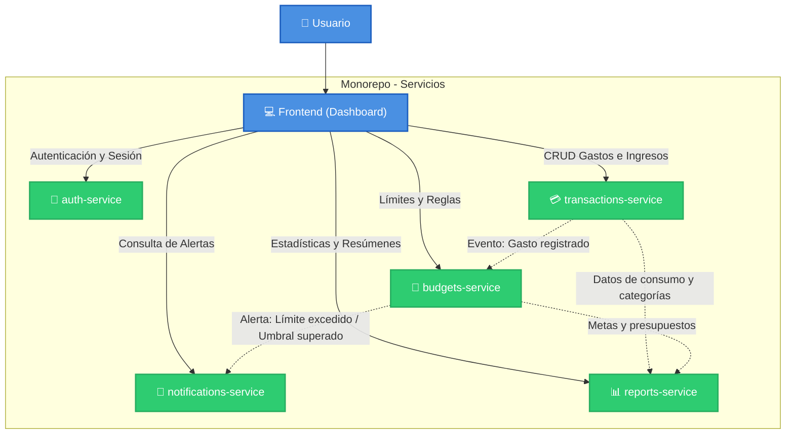

# Centavo 🪙

**Centavo** es una aplicación de finanzas personales diseñada para uso individual. Su objetivo es proporcionar un control claro, ágil y automatizado sobre las finanzas diarias, facilitando el registro de transacciones, la gestión de presupuestos por categoría y la detección proactiva de sobregastos mediante alertas en tiempo real.

---

## 🏛️ Arquitectura del Sistema

La solución adopta una arquitectura basada en **microservicios independientes** organizados en un **monorepo**. Cada servicio tiene una responsabilidad de negocio delimitada y gestiona su propio almacenamiento/lógica.



---

## 📦 Estructura del Monorepo

```text
centavo/
├── README.md
├── frontend/                 # Aplicación web / Dashboard interactivo
├── auth-service/             # Servicio de autenticación y credenciales
├── transactions-service/     # Registro, categorización y consulta de transacciones
├── budgets-service/          # Definición y seguimiento de presupuestos
├── notifications-service/    # Emisión y entrega de alertas de sobregasto
└── reports-service/          # Generación periódica y bajo demanda de reportes
```

---

## 🧩 Componentes y Responsabilidades

### 1. [Frontend (Dashboard)](file:////wsl.localhost/Ubuntu/home/carla3/ANTIGRAVITY/centavo/frontend)
* **Propósito:** Interfaz de usuario intuitiva y accesible para la gestión financiera personal.
* **Funcionalidades principales:**
  * Vista general del balance, gastos recientes y estado de presupuestos.
  * Formulario rápido para el registro de transacciones (ingresos/egresos).
  * Configuración visual de presupuestos y topes de gasto.
  * Centro de notificaciones con alertas visuales de sobregasto.
  * Gráficas interactivas y descarga de reportes.

---

### 2. [auth-service](file:////wsl.localhost/Ubuntu/home/carla3/ANTIGRAVITY/centavo/auth-service)
* **Propósito:** Gestión de identidad, seguridad y acceso a la plataforma.
* **Funcionalidades principales:**
  * Registro, inicio de sesión y gestión de credenciales del usuario.
  * Generación, validación y renovación de tokens de sesión (JWT).
  * Autorización para las peticiones hacia el resto de microservicios.

---

### 3. [transactions-service](file:////wsl.localhost/Ubuntu/home/carla3/ANTIGRAVITY/centavo/transactions-service)
* **Propósito:** Núcleo transaccional de gastos e ingresos.
* **Funcionalidades principales:**
  * CRUD de transacciones (monto, fecha, descripción, método de pago).
  * Categorización automática o manual (ej. Alimentación, Transporte, Ocio, Servicios).
  * Filtros de búsqueda cronológica y por categoría.
  * Emisión de eventos cuando ocurre una nueva transacción.

---

### 4. [budgets-service](file:////wsl.localhost/Ubuntu/home/carla3/ANTIGRAVITY/centavo/budgets-service)
* **Propósito:** Control de metas de gasto y techos presupuestarios.
* **Funcionalidades principales:**
  * Creación y ajuste de presupuestos periódicos (mensuales, semanales) por categoría.
  * Cálculo en tiempo real del porcentaje de consumo del presupuesto.
  * Evaluación de reglas de sobregasto (ej. advertencia al 80%, alerta crítica al 100%).
  * Solicitud de generación de alertas a `notifications-service`.

---

### 5. [notifications-service](file:////wsl.localhost/Ubuntu/home/carla3/ANTIGRAVITY/centavo/notifications-service)
* **Propósito:** Gestión y envío de avisos y recordatorios al usuario.
* **Funcionalidades principales:**
  * Recepción de eventos de advertencia y sobregasto originados en `budgets-service`.
  * Persistencia del historial de notificaciones in-app.
  * Envío de alertas a través de canales configurados (correo electrónico, push, notificaciones en dashboard).

---

### 6. [reports-service](file:////wsl.localhost/Ubuntu/home/carla3/ANTIGRAVITY/centavo/reports-service)
* **Propósito:** Análisis de datos, consolidación y generación de reportes periódicos.
* **Funcionalidades principales:**
  * Agregación de métricas financieras (promedios de gasto, categorías de mayor consumo, ahorro neto).
  * Generación programada de resúmenes (ej. reporte mensual o semanal).
  * Exportación de reportes a formatos descargables (PDF, CSV).
